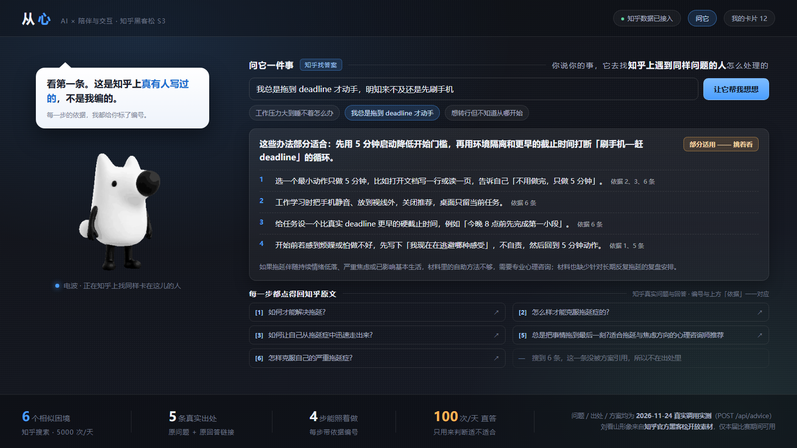

# P1 · 三件产出（AI 起草版 · **已拍板 2026-11-17 22:5x + 2026-11-18**）

> **状态：🟡 7 件事已拍板；台词逐句与镜头仍待人审。** 这一页里的**内容**（台词、节奏、镜头）必须由人拍板；AI 只负责排版与绘制。
> **每一条都标了来源**：`【实】` = 已实测的真实数据 ｜ `【提】` = AI 提案 ｜ `【已】` = 已拍板 ｜ `【未】` = 契约里已定但**代码还没写**。
>
> ⚠️ **D66（2026-11-24）：主线换了 ——「照镜子 · 认知闭环」整段下线，「问它」上线。**
> 本页 §1.2 / §2.3 / §2.4 / §2.5 已按新主线重写；
> **§2.6 末尾那张表、§2.7、以及 §三 静帧 2 仍带旧主线的痕迹，已逐处标注**。
>
> **已拍板的三件事（2026-11-17 22:5x）**：
> 1. **主流程一句话 = 候选 A**（出处 + 分歧 + 桌宠干活）
> 2. **照镜子一句话 = 候选 A**（自述 + 行为两侧都说全）
> 3. **口径统一为 67%**（工具与环境 4 + 工程与方法 2 = 6/9），**不用 44%，也不再用 82%**
>
> **又拍板四件事（2026-11-18）**（详见 §四，决策记录见 `docs/decisions.md` D33）：
> 4. **台词语气做成可选项，默认温和陪伴** —— 文案进契约层 `contracts/tone.json`，接口 `GET /api/tone`
> 5. **Demo 素材用真实知乎数据，不写死某一份文档** —— 实时拉收藏，每次跑出来可以不一样
> 6. **断层断言句保留，不软化** —— 不确定性用 `confidence_note` + 证据兜
> 7. **无刘看山版的静帧本期不做** —— 先跳过
>
> **事实底座（2026-11-17 实测，`server/scripts/smoke.js` 可复现）**：
>
> | 项 | 真实值 |
> | --- | --- |
> | 收藏 | **9 条**，1 个收藏夹 |
> | 收藏分类 | 工具与环境 4（44%）· 工程与方法 2（22%）· 资讯与生态 1 · 认知与判断 1 · 未归类 1 |
> | **口径（已定）** | **前两类合计 6/9 = 67%** ——「怎么立刻上手」的那一批 |
> | 收藏跨度 | 2023-11-03 → 2025-12-20，**778 天，集中在 6 天** |
> | 关注 | **3 个**：工程与方法 / 资讯与生态 / 职业与行业，**各类各 1 条** |
> | 创作 | **1 条**（pin《从心--ai宠物》），论证结构「痛点式」——**与「步骤式」同分，是弱结论** |
> | ★ 关键原话 | 用户自己在创作里写的：**「我的收藏夹里有 200 篇 PDF，一篇都没用上。」** |

---

## 一、一句话场景 ×2

### 1.1 主流程（3 分钟）　**【已】选候选 A**

> **【已】候选 A**
> 你拖进来一堆资料，桌宠嚼完吐出几张**每张都能点回原文**的卡片；你说「再多说点」，它转身去知乎捞出**真实存在、互相矛盾**的回答——它不给你答案，它把分歧摆在你面前。

备选（未采用，保留备查）

> **【提】候选 B（更强调"陪你干活"）**
> 你在赶一份报告，桌宠一直趴在你手边：你丢给它一份 PDF，它嚼出一叠带出处的卡片；你卡住了，它不催你，它去知乎把**吵得最凶的两方**翻出来摆给你看。

> **【提】候选 C（最强调"不编"）**
> 桌宠不吃黑盒摘要——它吐出的每张卡片都能点回知乎上的真实原回答，连「大家怎么看」也只给**带链接的真实分歧**，不给它自己编的总结。

**为什么选 A**：它一句话里同时装了三样东西——**出处（可信）**、**分歧（创新）**、**桌宠在干活（陪伴）**。
B 的问题在评审只给 3 分钟，"赶报告"这个铺垫太慢；C 最干净但少了"桌宠"这个主角，像在介绍一个检索产品。

### 1.2 「问它」环节（1.5 分钟）　**【已】候选 A（D66 重写，待人审）**

> **【已】候选 A**（2026-11-24 按 D66 重写 —— 原文的「照镜子 · 断层 · 认知地图」整段下线）
> 你抛一件正困扰着你的事，桌宠转身去知乎上找**遇到过同样问题的人**——
> 它从那些真实回答里判断**这些办法适不适合你这个具体情况**，给你一个**能照着做**的方案，
> **每一步后面都标着「依据第几条」**，点开就是知乎原文。

备选（未采用，保留备查）

> **【提】候选 B（更强调"不编"）**
> 知乎上有人遇到过一样的事，他们写了怎么做的；桌宠把他们的原话翻出来，判断哪几条适合你现在这个情况，凑成一份你能今晚就做的清单——**凑不上的那几条它会说不适合，而不是硬塞给你**。

> **【提】候选 C（用你自己的话）**
> 你自己写过「我的收藏夹里有 200 篇 PDF，一篇都没用上」——桌宠现在不再给你看断层，它直接问你：**那你现在卡住的是哪件事？**

**为什么这么选**：新主线要装三样东西——**困境的相似性（知乎上真有人遇到过）**、**判断（适不适合你）**、**可执行（能照着做的方案）**，
而且**出处必须能点回原文**（与卡片主流程同一条硬规则）。
B 更强调「不编」，但没点出「判断适不适合」这层 —— 那是这条线比搜索工具值钱的地方，不能省。
C 情绪最狠，但**没兑现「它去知乎找相似困境」** —— 那是新主线的核心动作。

> ⚠️ **D29 原 §1.2 的「照镜子环节（候选 A）」随认知闭环下线作废**（D66）。

---

## 二、5 分钟 Demo 逐秒脚本

> **配速**：主流程 3:00 + 照镜子 1:30 + 开场收尾 0:30。
> **主叙事是「桌宠在陪你干活」，不是「我们检索了知乎」**（D29 结论 3）——每一拍都要看得出桌宠在动、话在替用户说。
> **「实」= 屏幕上的数字/链接是真的｜「提」= 台词与镜头是提案｜「未」= 接口在契约里但代码还没写**
>
> **台词已经进契约层**（`contracts/tone.json`，14 句 × 2 个语气）——下面表里的台词就是契约里的原文，
> 前端**从 `GET /api/tone` 取**，不要自己抄一份。语气默认温和陪伴，可切换。
>
> **「桌宠台词」列里混了两种字，看的时候要分清**（11-19 逐句审时对出来的）：
> **气泡**＝桌宠说的话（14 句语气台词，全在 `contracts/tone.json` 里）；
> **面板上的字**＝后端按真实数据生成的**数据陈述句**（断层标签、「你做的：」那行、证据栏），
> **不随语气变、也不在语气目录里**。凡是写「（面板上的字）」的，**照抄屏幕原文，别改写**——
> 改写了就会变成「脚本说会演、屏幕上没有那一句」。

### 2.1 开场（0:00 — 0:15）

> ✅ **✅ 2026-11-22 17:1x 已拍板：桌宠先出场，日报紧跟**
> （赛道定为「AI × 陪伴与交互」见 [D54](../docs/decisions.md)；开场口径见 [D55](../docs/decisions.md)）
>
> **拍板结论**：**产品首屏不动**（仍是《从心日报》头版，不改前端 → **不用重出交付包**），
> **录屏第一下点「翻开内页 ↓」**，开场 15 秒的顺序是 **桌宠先出场 → 日报紧跟 → 接原来的 0:15 拍**，后 17 拍全部不变。
>
> **为什么这么定**：赛道定陪伴 → 第一眼必须是桌宠（这是**身份**）；
> 但日报是「数据是真的、每条能点回原话」的硬证据 → 0:05 亮一瞥，不能省（这是**信任**）。
> **台词一个字没改**（`contracts/tone.json` 14 句 × 2 语气原样不动）——
> 新增的「日报亮相」一拍是**无台词纯画面**，不发明台词，否则会踩 D44「脚本说会演、屏幕上没有那一句」。
>
> ⚠️ **AI 11-22 早先给的「A：把首屏拍成日报」建议已随 D55 撤销**（那条的前提是「首屏当日报」，与本条冲突）。
>
> **仍属 P1 内容、待人审的**：下面三拍的具体镜头与滚动节奏（滚上滚下的手法、每拍停留秒数）。
> **§2.5 的接口状态表不用改**——日报不新增任何接口。

| 时间 | 画面 | 桌宠台词 | 来源 |
| --- | --- | --- | --- |
| 0:00—0:05 | **录屏第一下点「翻开内页 ↓」** → 进入桌宠工作台：桌宠（`idle`）趴右下角，屏幕左侧摊着一堆**真实收藏条目**（标题 + 知乎链接，实时拉取） | 「这周的报告材料还在桌面上摆着，我看着都晃。」 | 【实】★ 实时 `GET /api/behavior/favorites` ·【实】★ 契约 `lines.opening`（前端确实从语气目录取，见 `web/js/app.js:884`） |
| 0:05—0:10 | **滚回页面顶部 →《从心日报》头版铺满**：刊名「从心日报」· 副题「知乎真实收藏 · 每日一印」·「第 N 期 · 当天日期」（11-22 实跑是第 326 期）·「今日索引 你收藏 / 读过的 9 条」· 每条带作者 / 日期 / 类型 / 域名 | （**无台词**——纯画面，让评委看清这些数字是真的） | 【实】★ 11-22 实跑首屏实拍 ·【提】★ 停留时长与滚动手法待人审 |
| 0:10—0:15 | 滚回工作台 → 桌宠转头（`greet`），气泡冒出来 | 「要不我先啃一口？」 | 【实】★ 契约 `lines.offer` |

### 2.2 主流程（0:15 — 3:00）

| 时间 | 画面 | 桌宠台词 | 来源 |
| --- | --- | --- | --- |
| 0:15–0:30 | 用户把「我的收藏」拖到桌宠身上 → 条目被吸入 → 角色轻微缩放 | （无台词） | 【实】★ 素材是**实时拉的该账号真实收藏**，不写死任何一篇文档 ·【提】交互 |
| 0:30–0:50 | 桌宠切 `thinking`（电波，头顶亮灯泡） | 「唔…有点硬，我再嚼嚼。」 | 【实】★ 契约 `lines.chew` |
| 0:50–1:15 | 卡片从桌宠位置飞出，排成 3 张，每张右下角有出处角标 | 「嚼出来了。这几张，每张都能点回原文。」 | 【实】★ 契约 `lines.digest` · 卡片内容是真实收藏 |
| 1:15–1:45 | 镜头推近第 1 张卡片 → 点「出处」→ 新标签打开**知乎原回答** | 「看第一条。这是知乎上真有人写过的，不是我编的。」 | 【实】★ 契约 `lines.source` ·【实】★ 真实知乎链接 |
| 1:45–2:15 | 点「知乎上大家怎么说」→ 桌宠又切电波 → 右侧滑入 **2 张观点卡：同一个知乎问题下的两条回答**（⚠️ 上游回答对象只有 4 个字段，**没有作者、没有立场** →「来自两个不同的人、观点相反」**数据层验证不了**，界面不这么写） | 「同一个问题的两条答案，我都带来了——原话，附链接。」 | 【实】★ 契约 `lines.viewpoints` ·【实】★ `question_recommendations` + `question_answers` ·【实】★ 11-19 实跑「同题两答」 |
| 2:15–2:45 | 两张观点卡并排，中间一条若隐若现的分界线（**只做视觉暗示，不解释**） | 「同一个问题，两条答案。我不替你选。」 | 【实】★ 契约 `lines.disagree` · **11-19 用户拍板改稿**（原句「它们说的是反的。我不替你选。」**数据层验证不了**，改成可证版本） |
| 2:45–3:00 | 桌宠回 `idle`，卡片收进右侧栏 | 「先放着吧。用不上的资料，堆着也是心里堵。」 | 【实】★ 契约 `lines.park` ·【实】呼应后面 4:05 的用户原话 |

### 2.3 「问它」环节（3:00 — 4:30）

> ⚠️ **D66（2026-11-24）**：原「照镜子环节」（自述问卷 → 断层 → 2.5D 认知地图 → 情境题 → 作答长地块）**整段下线**，
> 换成下面这 6 拍。**台词目录 14 句一个字没动**；新出现的几句桌宠话（标了「不在台词目录」）是**前端固定文案**，
> **要用户拍板**：是并进目录、还是改用现有 key、还是就这样留着。

| 时间 | 画面 | 桌宠台词 | 来源 |
| --- | --- | --- | --- |
| 3:00–3:10 | 工作台切到「**问它 · 它帮你找答案**」那一栏 → 桌宠转头（`greet`）主动开口 | 「有想不通的事就说一声，我上知乎替你翻翻。」**（不在台词目录里）** | 【实】★ 切到那一栏时自动说（`web/js/app.js`）·⚠️ **待人审** |
| 3:10–3:20 | 演示者在输入框里打一句话（示例问题「工作压力大到睡不着怎么办」）→ 点「**让它帮我想想**」 | （无台词） | 【实】★ `POST /api/advice` 已实现并实跑通过 |
| 3:20–3:40 | 桌宠切 `thinking`（电波，头顶亮灯泡）；结果区显示「正在知乎上找相似的人怎么处理的……」 | 「我去知乎上找找，看有没有人遇到过一样的。」**（不在台词目录里）** | 【实】★ 等待期间的真实状态 ·⚠️ **待人审** |
| 3:40–4:10 | **方案卡落下**：一句话结论 + 「**这些办法对你适用**」标签 + **5—6 步方案**，每一步后面跟着「**依据 N、M 条**」 | （无台词） | 【实】★ 11-24 实测：判断 `applicable` + 6 步方案 |
| 4:10–4:20 | 镜头往下滚到「**依据**」区：4 条真实知乎出处，每条带问题标题 + 作者 + 赞同数 | 「看第一条。这是知乎上真有人写过的，不是我编的。」 | 【实】★ 契约 `lines.source`（11-24 起这句挂在「问它」的结果上） |
| 4:20–4:30 | 点开一条出处 → 新标签打开**知乎原回答** | （无台词） | 【实】★ 真实知乎链接（`zhihu.com/question/…/answer/…` 与 `zhuanlan.zhihu.com/p/…`） |
| ⚠️ **边界态**（**只有搜不到、或对不上出处时才会出现**） | 结果区显示「知乎上暂时没搜到跟这个问题相关的内容」/「这次没能把建议对上知乎原文出处」 | 「这次没找到能对得上的。我不给你一个查无出处的答案。」**（不在台词目录里）** | 【实】★ 后端 `empty_notice`（**不编答案**）·⚠️ **待人审** |

> **这一段为什么不需要等**：工作台是「固定高度 + 内部滚动」窗口，答案渲染在窗口内部 ——
> 代码里加了 `revealAskResult()`，出结果后**自动滚进视野**，所以「点了没反应」这个坑已经填了（11-24 实测）。

### 2.4 收尾（4:30 — 5:00）

| 时间 | 画面 | 桌宠台词 | 来源 |
| --- | --- | --- | --- |
| 4:30–4:50 | 方案卡 + 依据列表同框（不用再滚），桌宠回 `idle` | 「从心。你想清楚了什么，它才算数。」 | 【实】★ 契约 `lines.closing` |
| 4:50–5:00 | 回到桌宠（`idle`），落版：作品名「从心」· 赛道 AI × 陪伴与交互 · 一行字「每张卡片都能点回知乎原话」 | | 【提】· ✅ **已实现（11-20）**：顶栏「落版」按钮 / 键盘 `O`、`End` 出、`Esc` 关 / `?demo=1` 演练结束自动出；**这一拍没有台词**（台词在上一拍 4:30—4:50 的 `closing`），所以**不归语气目录管** |

### 2.5 ★ 这份脚本里每个接口的代码状态

| 契约接口 | 状态 | 实测结果 |
| --- | --- | --- |
| `GET /api/behavior/favorites` / `followees` / `contents` | ✅ 已实现，真调知乎跑通 | 收藏 9 条 / 关注 3 个 / 创作 1 条 |
| `GET /api/quota` | ✅ 已实现 | 9 类额度 |
| `POST /api/cards`（含 `same_question=true`） | ✅ 已实现 | 3 张带出处三件套的真卡；同题两答同一 `question_url`、不同 `answer_url` |
| **`POST /api/advice`**（**新主线**） | ✅ **已实现并实跑通过**（11-24 两次） | 问「工作压力大到睡不着怎么办」→ 判断 `applicable` + 一句话结论 + **5 步方案**（每步带「依据 N 条」）+ **5 条真实出处**；问「我总是拖到 deadline 才动手…」→ 判断 `partially_applicable` + **4 步方案** + **5 条真实出处**；再问一次命中缓存（3 毫秒） |
| `GET /api/tone` | ✅ 已实现 | 14 句 × 2 语气，默认 gentle |

> **别把这份脚本当成"已完成"的演示**：接口都通了，而且**前端 `web/` 已写完并实跑通过**（真实知乎数据、无 mock；
> `?demo=1` 已重写成 6 步：喂收藏 → 知乎补观点 → 翻到「问它」→ 抛问题出方案 → 落版）。
> ✅ **台词已拍板（2026-11-24，D68）**：用户说「**台词先这样**」= **保持现状，一个字都不增不删**。
>   逐句对照见 **§2.6**；新主线的 3 句桌宠话**继续当前端固定文案，不进台词目录**。

### 2.6 ★ 台词逐句审 · 对照表（AI 预审，2026-11-19 16:4x）

> **这一节是给人审的**：台词是内容层，只能用户拍板；AI 只负责把「脚本排的」与「代码真的会说的」对齐，
> 免得逐句审时漏掉对不上的地方。**下面台词一个字都没改**，全部是 `contracts/tone.json` 里的原文。

| # | key | 温和陪伴（默认）原文 | 脚本位置 | 前端什么时候说 | 一致？ |
| --- | --- | --- | --- | --- | --- |
| 1 | `opening` | 这周的报告材料还在桌面上摆着，我看着都晃。 | 0:00 | 首屏加载完 | ✅ 脚本原标【提】，**实际已进契约**（本轮已改成【实】） |
| 2 | `offer` | 要不我先啃一口？ | 0:15 | 收藏读完后自动说 | ✅ |
| 3 | `chew` | 唔…有点硬，我再嚼嚼。 | 0:30 | 点「用我的收藏喂它」 | ✅ |
| 4 | `digest` | 嚼出来了。这几张，每张都能点回原文。 | 0:50 | **卡片渲染出来之后**（11-19 16:3x 改，D44） | ✅ 时机已对齐 |
| 5 | `source` | 看第一条。这是知乎上真有人写过的，不是我编的。 | 1:15 · **4:10** | 点卡片（**只对带知乎出处的卡**）／**「问它」结果出来后** | ✅ 两处都在用（11-24 起第二处） |
| 6 | `viewpoints` | 同一个问题的两条答案，我都带来了——原话，附链接。 | 1:45 | **两张观点卡渲染出来之后**（同上） | ✅ 时机已对齐 |
| 7 | `disagree` | 同一个问题，两条答案。我不替你选。 | 2:15 | 观点卡出来后 **2 秒** | ✅ 两句都能被看到（`pet.say()` 是替换不是排队，原来后一句会顶掉前一句） |
| 8 | `park` | 先放着吧。用不上的资料，堆着也是心里堵。 | 2:45 | 点「收起来」 | ✅ |
| 9 | `mirror` | 等一下——我看你收藏的这些，跟你刚才说的不太一样。照照镜子？ | ~~3:00~~ | 认知闭环下线，**新主线不再调用** | ✅ **D68：保持现状 —— 台词保留在目录里不删，但新主线不调用** |
| 10 | `fracture` | 你不是没有体系，你是一遇任务就只做眼前那一步。 | ~~3:50–4:05~~ | 断层算完后自动说 —— **断层已下线** | ✅ **D68：保持现状 —— 保留在目录里不删，新主线不调用** |
| 11 | `question` | 那这道呢——你打算怎么让它用上？ | ~~4:15~~ | 情境题已下线，**新主线不再调用** | ✅ **D68：保持现状 —— 保留在目录里不删，新主线不调用** |
| 12 | `bridge` | 行，这块地是你的了。 | ~~4:25~~ | 地形作答已下线，**新主线不再调用** | ✅ **D68：保持现状 —— 保留在目录里不删，新主线不调用** |
| 13 | `closing` | 从心。你想清楚了什么，它才算数。 | 4:30 | 收尾拍 | ✅ |
| 14 | `insufficient` | 这次信号不够我下判断——先不照了。 | ~~边界态（3:25）~~ | 信号不足已不存在；**新主线的边界态走前端固定文案** | ✅ **D68：保持现状 —— 保留在目录里不删，新主线用前端固定文案** |

**不在语气目录里的 3 句**（这是对的，符合 `contracts/tone.json` 规则第 2、3 条）：

> ✅ **D68 已拍板（2026-11-24，用户原话「台词先这样」）**：**保持现状** ——
> ① 目录里那 14 句**一个字都不增不删**（含认知闭环下线后不再调用的 5 句，**保留不删**）；
> ② 下面这 3 句**继续当前端固定文案**，**不进台词目录**；
> ③ 新主线**不新增任何台词**。

> ⚠️ **D66（2026-11-24）：认知闭环下线 → 旧的三句断层数据陈述句全部作废**
> （断层 `label` / `behavioral_side.summary` / 用户创作原话三条线都不再调用了）。
> 下表是**新主线**的 3 句 —— **目前是前端固定文案**（`web/js/app.js` 的 `sayText`），
> **不在 `contracts/tone.json` 的 14 句目录里**。**AI 不得自行把它们写进台词目录**；
> **怎么处置（加进目录 / 就当前端固定文案 / 改写）要用户拍板**。

| 位置 | 句子 | 谁生成 | 状态（11-24） |
| --- | --- | --- | --- |
| 面板提示 | 「有想不通的事就说一声，我上知乎替你翻翻。」 | **前端固定文案**（`web/js/app.js` `renderAskPanel`） | ✅ **D68：保持现状 —— 继续当前端固定文案，不进台词目录** |
| 请求发起时 | 「我去知乎上找找，看有没有人遇到过一样的。」 | **前端固定文案**（`app.js` `askAdvice`） | ✅ **D68：同上** |
| 空结果 / 边界态 | 「这次没找到能对得上的。我不给你一个查无出处的答案。」 | **前端固定文案**（`app.js` `askAdvice` 空分支） | ✅ **D68：同上**；**空数据时说真话**（D62） |

### 2.7 ★ 台词逐句审 · 3 件事 · **已拍板（2026-11-19 15:3x）**

> ⚠️ **D66（2026-11-24）：本节第 1、2 条已随认知闭环下线作废**
> —— `fracture` / `insufficient` 两句**不再被任何代码调用**（断层、情境题、地形三个接口都已下线）。
> 下面保留原文作为**当时拍板的记录**（决策层只增不改），**但主持人不要照着操作**。
> 第 3 条（4:05 补操作提示）同样失效——**「看地形」「点断层标记」这两个操作在新主线里不存在了**。
> **新主线怎么演，见 §2.3 / §2.4 / §2.5（已按 D66 重写）。**

> **用户 11-19 15:3x 拍板**（四项均按 AI 的推荐选项）：`fracture` 与 `insufficient` **两句都排进脚本**；
> 4:05 那一拍**补上「等 4—5 秒再点断层标记」的操作提示**。
> **台词本身一个字没改**——只改「排不排」和「脚本怎么写」。

1. **`fracture` 排进脚本** → 已落在 **3:50–4:05**，与数据陈述句同一拍。
   - 依据：代码在断层算完后**自动**说这一句（`web/js/app.js:712`）——**不排就是让台上出现脚本外台词**。
   - 顺带一问（AI 判断，非用户拍板）：**这句算不算「数字结论」**？它不带数字，不违反「台词里不许写数字结论」；
     但它**带判断**——不确定性由证据栏 `confidence_note` 兜（`contracts/tone.json` 规则第 4 条只禁数字，不禁判断）。
2. **`insufficient` 排进脚本** → 已落在 **「边界态」一行**（3:25 那一拍，**只有信号不足时才会出现**）。
   - 正常演示 3 个信号够用，**不会触发**；排进去是给主持人兜底：万一触发，**照念即可，不用救场**。
3. **4:05 补操作提示** → 已写进逐秒脚本的画面列：
   **点「看地形」→ 等地图出来（实测 ≈4—5 秒）→ 再点断层标记 → 桌宠才说那句原话。**
   - 依据：实测量图要 4—5 秒，**点早了会点到还没渲染完的地图上，那一拍就是空的**。
   - ⚠️ 这条是**给主持人自己看的操作备忘，不上台念**。

**另外校准了一处（不在原 3 件事里）**：脚本 3:25 / 3:50 引的那两句「数据陈述句」**原来是意译，不是屏幕原文**
（详见 §2.6 表下方的校准说明）。已照抄后端 `label` / `behavioral_side.summary` 逐字改正——
**这是同一类毛病**：台词不许早于事实，**脚本引的也不许不是事实**。

---

## 三、静帧 ×2

> ✅ **已定（2026-11-24）**：用户说「**图片你上新**」→ 静帧 2 **按新主线重画**，
> 主题从「2.5D 认知地图 + 断层」换成「**问它**」；旧的 `frame-2-terrain-fracture.*` **已删除**（概念已下线，留着会被误当成现行插图）。
> **画面里的每一条数据都是真的**（11-24 真实调用 `POST /api/advice` 的那次输出：问题 / 判断 / 4 步方案 / 5 条出处 / 依据编号）。

| # | 画面 | 用途 | 文件 |
| --- | --- | --- | --- |
| 静帧 1 | **桌宠 + 卡片**：桌宠在左侧电波，右边是带出处角标的卡片与知乎观点对照 | 计划书封面 / Demo 备用画面 | `docs/p1-frames/frame-1-pet-cards.png` |
| 静帧 2 | **「问它」新主线**：左边桌宠在电波，右边是问题输入 → 适用性判断 → **每步带依据编号**的方案 → 出处列表（编号一一对应） | ✅ **已按新主线重画**（11-24） | `docs/p1-frames/frame-2-ask.png` |

**静帧 1**

**静帧 2**

**两张都是用真实素材搭的**：刘看山用官方 `assets/kanshan/` 的真帧（**不自绘角色**，D19），**静帧 2 的问题、判断、方案、编号、出处全部是 11-24 真实调用的输出**，没有一处是编的。

> **HTML 稿是源文件**，改文案改排版直接改 `docs/p1-frames/*.html`，然后用本机 Chrome 无头重出 PNG（命令见 `docs/handoffs/2026-11-17-2250-taxonomy-server-p1.md` 第 4 节）。

> **无刘看山版的静帧本期不做**（2026-11-18 拍板）：只出上面这两张。
> 原因：官方刘看山 IP **仅本届比赛期间可用，赛后禁商用**；为「赛后还能用」而多做一套占位版，
> 在 19 天预算里**换不到评审加分**，而自绘角色要重算 20—30 人时（D19）。
> 赛后若要继续用这个项目，再单独评估换素材或重画角色的成本（风险已留痕在 `docs/decisions.md` D33）。

> ⚠️ **静帧 1 里的「正 / 反」角标是设计稿，产品里不做**（2026-11-19 记）。
> 上游回答对象**只有 4 个字段，没有作者也没有立场** → **数据层分不出「正反」**，
> 界面上写「正/反」就是编（D37 结论 3）。
> **产品里的真实形态**：`web/` 的「知乎上大家怎么说」是
> **「同一个问题的两条回答」**——问题标题只出现一次，两张卡标成「回答 ① / 回答 ②」，
> 中间一条 VS 分界线（P1 脚本原话：「只做视觉暗示，不解释」）。
> 静帧 1 是**设计稿不是产品截图**，所以角标保留；台词已按 D38 同步成可证版本。

---

## 四、已拍板的 4 件事（2026-11-18）

> 已拍板的 3 件事（场景 A/A、口径 67%）见文首。下面 4 件是 2026-11-18 拍的，**结论已落到代码与契约层**。

1. **桌宠台词的口语度** → **【已】做成可选项，默认温和陪伴。**
   文案进契约层 `contracts/tone.json`（唯一真源，14 句 × 2 个语气）；
   新增 `GET /api/tone` 一次给全「切换器选项 + 全部台词」；
   4 个认知接口接受可选 `tone`，响应回 `tone` + `pet_lines`。
   **默认值被用户拍板过 → 自检第 13 项机器校验 `default === 'gentle'`，手滑改会被拦下。**
   **边界（已实测）**：换语气只改说法，断层 `label` / 强度 / 置信度 / 证据数**逐字不变**。

2. **零点几秒开场的「报告材料」** → **【已】用真实的知乎数据，不写死某一份文档。**
   开场那堆资料 = 实时 `GET /api/behavior/favorites` 拉到的该账号真实收藏；
   情境题与观点卡本来就是实时上游。**前端不内置任何 mock 素材**，每次跑出来可以不一样。

3. **断层那句话的主语** → **【已】保留断言版，不软化。**
   还是「你不是没有体系，你是一遇任务就只做眼前那一步」——
   不确定性用 `confidence_note`（本次 0.6 / 由 3 个信号推断 / 创作只有 1 条）+ `behavioral_side.evidence`（4 条真实收藏）兜。
   **软化文案是把不确定性藏起来；把不确定性放进证据栏是把它摆出来。**

4. **静帧要不要换「没有刘看山」的版本** → **【已】本期不做，先跳过。**
   官方 IP 本届可用、赛后禁商用；多做一套占位版换不到评审加分，自绘角色要 20—30 人时。
   风险与赛后选项已留痕在 D33。

> **口径已统一为 67%**，并已写进零 J（**暂缓发送**，见 `docs/队友对齐清单.md`）——**已发出的零 I 里那个 82% 是示例数字，以零 J 为准。**

---

## 五、这份草稿的诚实边界

- **数字全部来自真实账号实测**（`node server/scripts/smoke.js` 可复现），没有一处是编的。
- **台词已经进契约层**（`contracts/tone.json`，2 个语气 × 14 句，可切换，默认温和陪伴）；
  **节奏与镜头仍是提案**，等用户逐句审。
- **Demo 素材是实时拉的**（真实收藏 + 实时上游问题）→ **每次跑出来的条目可能不一样**，
  但**口径不变**（67% = 工具与环境 4 + 工程与方法 2 = 6/9，取决于分类，不取决于素材顺序）。
- **9 个接口全部通了，但前端 `web/` 一行都还没写**——脚本是"要长成什么样"，不是"已经长成了"。
- **创作信号只有 1 条样本**，论证结构是弱结论——演示时不要拿它当结论讲。
- **断层文案里的 67% 是「工具与环境 4 + 工程与方法 2」两类合计**，分类口径见 `contracts/taxonomy.json`；如果队友改了类目，这个数会变。
- **换语气只改说法，不改事实**——断层强度、置信度、证据数量、分类占比一个都不动（已实测逐字相同）。
