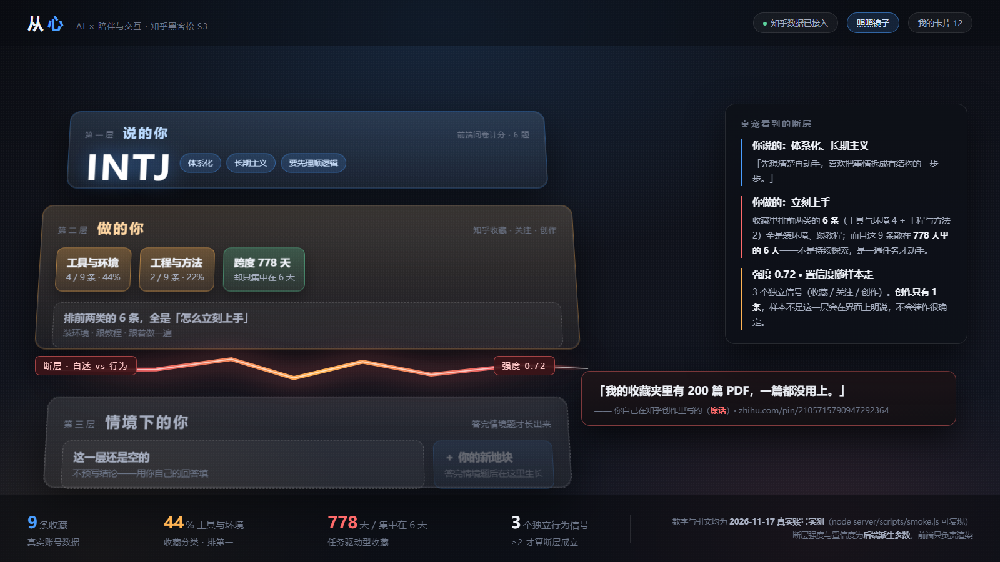

# P1 · 三件产出（AI 起草版 · **已拍板 2026-11-17 22:5x + 2026-11-18**）

> **状态：🟡 7 件事已拍板；台词逐句与镜头仍待人审。** 这一页里的**内容**（台词、节奏、镜头）必须由人拍板；AI 只负责排版与绘制。
> **每一条都标了来源**：`【实】` = 已实测的真实数据 ｜ `【提】` = AI 提案 ｜ `【已】` = 已拍板 ｜ `【未】` = 契约里已定但**代码还没写**。
>
> **已拍板的三件事（2026-11-17 22:5x）**：
> 1. **主流程一句话 = 候选 A**（出处 + 分歧 + 桌宠干活）
> 2. **照镜子一句话 = 候选 A**（自述 + 行为两侧都说全）
> 3. **口径统一为 67%**（工具与环境 4 + 工程与方法 2 = 6/9），**不用 44%，也不再用 82%**
>
> **又拍板四件事（2026-11-18）**（详见 §四，决策记录见 `docs/decisions.md` D33）：
> 4. **台词语气做成可选项，默认温和陪伴** —— 文案进契约层 `contracts/tone.json`，接口 `GET /api/tone`
> 5. **Demo 素材用真实知乎数据，不写死某一份文档** —— 实时拉收藏，每次跑出来可以不一样
> 6. **断层断言句保留，不软化** —— 不确定性用 `confidence_note` + 证据兜
> 7. **无刘看山版的静帧本期不做** —— 先跳过
>
> **事实底座（2026-11-17 实测，`server/scripts/smoke.js` 可复现）**：
>
> | 项 | 真实值 |
> | --- | --- |
> | 收藏 | **9 条**，1 个收藏夹 |
> | 收藏分类 | 工具与环境 4（44%）· 工程与方法 2（22%）· 资讯与生态 1 · 认知与判断 1 · 未归类 1 |
> | **口径（已定）** | **前两类合计 6/9 = 67%** ——「怎么立刻上手」的那一批 |
> | 收藏跨度 | 2023-11-03 → 2025-12-20，**778 天，集中在 6 天** |
> | 关注 | **3 个**：工程与方法 / 资讯与生态 / 职业与行业，**各类各 1 条** |
> | 创作 | **1 条**（pin《从心--ai宠物》），论证结构「痛点式」——**与「步骤式」同分，是弱结论** |
> | ★ 关键原话 | 用户自己在创作里写的：**「我的收藏夹里有 200 篇 PDF，一篇都没用上。」** |

---

## 一、一句话场景 ×2

### 1.1 主流程（3 分钟）　**【已】选候选 A**

> **【已】候选 A**
> 你拖进来一堆资料，桌宠嚼完吐出几张**每张都能点回原文**的卡片；你说「再多说点」，它转身去知乎捞出**真实存在、互相矛盾**的回答——它不给你答案，它把分歧摆在你面前。

备选（未采用，保留备查）

> **【提】候选 B（更强调"陪你干活"）**
> 你在赶一份报告，桌宠一直趴在你手边：你丢给它一份 PDF，它嚼出一叠带出处的卡片；你卡住了，它不催你，它去知乎把**吵得最凶的两方**翻出来摆给你看。

> **【提】候选 C（最强调"不编"）**
> 桌宠不吃黑盒摘要——它吐出的每张卡片都能点回知乎上的真实原回答，连「大家怎么看」也只给**带链接的真实分歧**，不给它自己编的总结。

**为什么选 A**：它一句话里同时装了三样东西——**出处（可信）**、**分歧（创新）**、**桌宠在干活（陪伴）**。
B 的问题在评审只给 3 分钟，"赶报告"这个铺垫太慢；C 最干净但少了"桌宠"这个主角，像在介绍一个检索产品。

### 1.2 照镜子环节（1.5 分钟）　**【已】选候选 A**

> **【已】候选 A**
> 你刚填完问卷说自己是「体系化、长期主义」，桌宠当场把收藏翻出来给你看：**9 条里 6 条是「怎么立刻上手」，而且散在 778 天里的 6 天**——它说「你不是没有体系，你是一遇任务就只做眼前那一步」，然后一道带知乎出处的情境题砸过来。

备选（未采用，保留备查）

> **【提】候选 B（更短更狠）**
> 你说自己是长期主义者，桌宠把 778 天的收藏记录摊开：跨度 778 天，却只集中在 6 天，全是「装环境、跟教程」——断层就在眼前裂开。

> **【提】候选 C（用你自己的话）**
> 你自己写过「我的收藏夹里有 200 篇 PDF，一篇都没用上」——桌宠把这句话，和它数出来的真实收藏结构并排放，中间裂开一道断层。

**为什么选 A**：A 把**自述**和**行为**两侧都说全了（这正是断层的定义），而且数字全部来自真实数据。
C 情绪最狠，但**只用了收藏这一侧的证据**，撑不起 `self_reported_vs_favorites` 这条断层轴——建议把它降级成 A 的**第 3 拍**（见脚本 4:05），当"补刀"用，不当开场。

---

## 二、5 分钟 Demo 逐秒脚本

> **配速**：主流程 3:00 + 照镜子 1:30 + 开场收尾 0:30。
> **主叙事是「桌宠在陪你干活」，不是「我们检索了知乎」**（D29 结论 3）——每一拍都要看得出桌宠在动、话在替用户说。
> **「实」= 屏幕上的数字/链接是真的｜「提」= 台词与镜头是提案｜「未」= 接口在契约里但代码还没写**
>
> **台词已经进契约层**（`contracts/tone.json`，14 句 × 2 个语气）——下面表里的台词就是契约里的原文，
> 前端**从 `GET /api/tone` 取**，不要自己抄一份。语气默认温和陪伴，可切换。
>
> **「桌宠台词」列里混了两种字，看的时候要分清**（11-19 逐句审时对出来的）：
> **气泡**＝桌宠说的话（14 句语气台词，全在 `contracts/tone.json` 里）；
> **面板上的字**＝后端按真实数据生成的**数据陈述句**（断层标签、「你做的：」那行、证据栏），
> **不随语气变、也不在语气目录里**。凡是写「（面板上的字）」的，**照抄屏幕原文，别改写**——
> 改写了就会变成「脚本说会演、屏幕上没有那一句」。

### 2.1 开场（0:00 — 0:15）

| 时间 | 画面 | 桌宠台词 | 来源 |
| --- | --- | --- | --- |
| 0:00 | 全屏桌面，桌宠（`idle`）趴右下角，屏幕上摊着一堆**真实收藏条目**（标题 + 知乎链接，实时拉取） | 「这周的报告材料还在桌面上摆着，我看着都晃。」 | 【实】★ 实时 `GET /api/behavior/favorites` ·【实】★ 契约 `lines.opening`（前端确实从语气目录取，见 `web/js/app.js:884`） |
| 0:15 | 桌宠转头（`greet`），气泡冒出来 | 「要不我先啃一口？」 | 【实】★ 契约 `lines.offer` |

### 2.2 主流程（0:15 — 3:00）

| 时间 | 画面 | 桌宠台词 | 来源 |
| --- | --- | --- | --- |
| 0:15–0:30 | 用户把「我的收藏」拖到桌宠身上 → 条目被吸入 → 角色轻微缩放 | （无台词） | 【实】★ 素材是**实时拉的该账号真实收藏**，不写死任何一篇文档 ·【提】交互 |
| 0:30–0:50 | 桌宠切 `thinking`（电波，头顶亮灯泡） | 「唔…有点硬，我再嚼嚼。」 | 【实】★ 契约 `lines.chew` |
| 0:50–1:15 | 卡片从桌宠位置飞出，排成 3 张，每张右下角有出处角标 | 「嚼出来了。这几张，每张都能点回原文。」 | 【实】★ 契约 `lines.digest` · 卡片内容是真实收藏 |
| 1:15–1:45 | 镜头推近第 1 张卡片 → 点「出处」→ 新标签打开**知乎原回答** | 「看第一条。这是知乎上真有人写过的，不是我编的。」 | 【实】★ 契约 `lines.source` ·【实】★ 真实知乎链接 |
| 1:45–2:15 | 点「知乎上大家怎么说」→ 桌宠又切电波 → 右侧滑入 **2 张观点卡：同一个知乎问题下的两条回答**（⚠️ 上游回答对象只有 4 个字段，**没有作者、没有立场** →「来自两个不同的人、观点相反」**数据层验证不了**，界面不这么写） | 「同一个问题的两条答案，我都带来了——原话，附链接。」 | 【实】★ 契约 `lines.viewpoints` ·【实】★ `question_recommendations` + `question_answers` ·【实】★ 11-19 实跑「同题两答」 |
| 2:15–2:45 | 两张观点卡并排，中间一条若隐若现的分界线（**只做视觉暗示，不解释**） | 「同一个问题，两条答案。我不替你选。」 | 【实】★ 契约 `lines.disagree` · **11-19 用户拍板改稿**（原句「它们说的是反的。我不替你选。」**数据层验证不了**，改成可证版本） |
| 2:45–3:00 | 桌宠回 `idle`，卡片收进右侧栏 | 「先放着吧。用不上的资料，堆着也是心里堵。」 | 【实】★ 契约 `lines.park` ·【实】呼应后面 4:05 的用户原话 |

### 2.3 照镜子环节（3:00 — 4:30）

| 时间 | 画面 | 桌宠台词 | 来源 |
| --- | --- | --- | --- |
| 3:00–3:10 | 桌宠突然抬头（`cheer`），气泡顶出来 | 「等一下——我看你收藏的这些，跟你刚才说的不太一样。照照镜子？」 | 【实】★ 契约 `lines.mirror` · 桌宠**主动发起** |
| 3:10–3:25 | 自述问卷（6 题）→ 出结果 | （用户自己答） | 【实】★ `POST /api/behavior/tension` 已实现 |
| 3:25–3:50 | 2.5D 认知地图升起：上层「说的你」/ 下层「做的你」/ 第三层「情境下的你」空着；**断层面板**给出断层标签与证据栏 | （**面板上的字，不是气泡**）「你说你重「长期主义」，但你收藏的 **67%（6/9 条）**是「怎么立刻上手」——装环境、跟教程、跟着做一遍。」 | 【实】★ **数据陈述句**（后端按真实数据生成，不随语气变）· `tension` 已实现 · ⚠️ **11-19 逐字校准**：这一句照抄后端 `label` 逐字；**旧稿写的是意译**（「你说你是体系化、长期主义。可你收藏的 9 条里…」），**屏幕上没有那句**——已改 |
| 3:50–4:05 | 「做的你」那层再压一句（面板），同时**桌宠气泡**补上断言 | （**面板上的字**）「收藏里排前两类的 6 条（工具与环境 + 工程与方法）都属于上手型；跨度 778 天却只集中在 6 天。」 （**桌宠气泡**）「你不是没有体系，你是一遇任务就只做眼前那一步。」 | 【实】★ **数据陈述句**（`behavioral_side.summary`，逐字）· 【实】★ 契约 `lines.fracture` · **11-19 用户拍板排进脚本**（代码在断层算完后**自动**说这一句，旧脚本漏排 → 台上会出现脚本外台词）· 口径与不确定性见证据栏 `confidence_note`：「收藏跨度 778 天但只集中在 6 天，是任务驱动型收藏——所以这个结论对「你在任务里怎么做事」解释力强，对「你平时怎么想」解释力弱。」 |
| 4:05–4:15 | ⏱ **操作提示（给主持人，不上台念）**：点「看地形」→ **等地图出来（实测 ≈4—5 秒）** → 再点断层标记 → 桌宠才说那句原话。断层在地图上裂开 → **Three.js 真 3D 推镜特写** | 「你自己也写过一句——『我的收藏夹里有 200 篇 PDF，一篇都没用上』。」 | 【实】★ 用户自己创作里的原话 · ⚠️ 这句**不进语气目录**（上游摘要会截断，要显示得由后端从创作信号取原文拼） · **11-19 用户拍板补上等待提示**（点早了会点到还没渲染完的地图上，那一拍就是空的） |
| 4:15–4:25 | 断层特写上浮出一道情境题（带知乎问题标题 + 链接） | 「那这道呢——你打算怎么让它用上？」 | 【实】★ 契约 `lines.question` · 情境题必带知乎出处 · `situation/question` 已实现 |
| 4:25–4:30 | 用户答完 → 地图第三层长出一块新地块 | 「行，这块地是你的了。」 | 【实】★ 契约 `lines.bridge` · `terrain/answer` 已实现 |
| ⚠️ **边界态**（3:25 那一拍，**只有信号不足时才会出现**） | 桌宠切 `idle`，断层面板显示「信号不够，断层不成立。」 | 「这次信号不够我下判断——先不照了。」 | 【实】★ 契约 `lines.insufficient` · **11-19 用户拍板排进脚本**（作为兜底；正常演示 3 个信号够用，**不会触发**）——这句念出来不尴尬，就是「不瞎猜」的意思；**主持人照念即可，不用救场** |

### 2.4 收尾（4:30 — 5:00）

| 时间 | 画面 | 桌宠台词 | 来源 |
| --- | --- | --- | --- |
| 4:30–4:50 | 全景 2.5D 地图，三层都有内容了，断层上多了一座桥 | 「从心。你想清楚了什么，它才算数。」 | 【实】★ 契约 `lines.closing` |
| 4:50–5:00 | 回到桌宠（`idle`），落版：作品名「从心」· 赛道 AI × 陪伴与交互 · 一行字「每张卡片都能点回知乎原话」 | | 【提】· ✅ **已实现（11-20）**：顶栏「落版」按钮 / 键盘 `O`、`End` 出、`Esc` 关 / `?demo=1` 演练结束自动出；**这一拍没有台词**（台词在上一拍 4:30—4:50 的 `closing`），所以**不归语气目录管** |

### 2.5 ★ 这份脚本里每个接口的代码状态

| 契约接口 | 状态 | 实测结果 |
| --- | --- | --- |
| `GET /api/behavior/favorites` / `followees` / `contents` | ✅ 已实现，真调知乎跑通 | 收藏 9 条 / 关注 3 个 / 创作 1 条 |
| `GET /api/quota` | ✅ 已实现 | 9 类额度 |
| `POST /api/behavior/tension` | ✅ **已实现**（22:5x） | 实跑输出断层：「你说你重「长期主义」，但你收藏的 **67%（6/9 条）**是「怎么立刻上手」」，强度 0.67 / 置信度 0.6 |
| `GET /api/terrain` | ✅ **已实现** | 三层各 5 个块，断层标记带 `axis_x/axis_y`（3D 推镜落点） |
| `POST /api/terrain/answer` | ✅ **已实现** | 实跑长出地形块并连上「内倾情感」的桥；伪造 question_id 正确返回 404 |
| `POST /api/situation/question` | ✅ **已实现** | 实跑出题：题面由 `zhida-fast-1p5` 改写，**出处（问题 URL + 原回答链接）来自上游**，模型不给出处 |

> **别把这份脚本当成"已完成"的演示**：接口都通了，而且**前端 `web/` 已写完并实跑通过**（真实知乎数据、无 mock；`?demo=1` 走完 **9/9 步、0 报错**），
> 3:00 之后的画面（问卷、2.5D 地图、断层标记、情境题、地形）**也都实现了**；
> ⚠️ 唯一没做的是 **4:05 的「Three.js 真 3D 推镜」**——当前是 **CSS 强视差**（保命砍法最后一位）。
> 台词逐句仍待用户审，见 **§2.6 逐句审对照表**。

> 复现：`node server/scripts/smoke-cognition.js`

---

### 2.6 ★ 台词逐句审 · 对照表（AI 预审，2026-11-19 16:4x）

> **这一节是给人审的**：台词是内容层，只能用户拍板；AI 只负责把「脚本排的」与「代码真的会说的」对齐，
> 免得逐句审时漏掉对不上的地方。**下面台词一个字都没改**，全部是 `contracts/tone.json` 里的原文。

| # | key | 温和陪伴（默认）原文 | 脚本位置 | 前端什么时候说 | 一致？ |
| --- | --- | --- | --- | --- | --- |
| 1 | `opening` | 这周的报告材料还在桌面上摆着，我看着都晃。 | 0:00 | 首屏加载完 | ✅ 脚本原标【提】，**实际已进契约**（本轮已改成【实】） |
| 2 | `offer` | 要不我先啃一口？ | 0:15 | 收藏读完后自动说 | ✅ |
| 3 | `chew` | 唔…有点硬，我再嚼嚼。 | 0:30 | 点「用我的收藏喂它」 | ✅ |
| 4 | `digest` | 嚼出来了。这几张，每张都能点回原文。 | 0:50 | **卡片渲染出来之后**（11-19 16:3x 改，D44） | ✅ 时机已对齐 |
| 5 | `source` | 看第一条。这是知乎上真有人写过的，不是我编的。 | 1:15 | 点卡片（**只对带知乎出处的卡**） | ✅ |
| 6 | `viewpoints` | 同一个问题的两条答案，我都带来了——原话，附链接。 | 1:45 | **两张观点卡渲染出来之后**（同上） | ✅ 时机已对齐 |
| 7 | `disagree` | 同一个问题，两条答案。我不替你选。 | 2:15 | 观点卡出来后 **2 秒** | ✅ 两句都能被看到（`pet.say()` 是替换不是排队，原来后一句会顶掉前一句） |
| 8 | `park` | 先放着吧。用不上的资料，堆着也是心里堵。 | 2:45 | 点「收起来」 | ✅ |
| 9 | `mirror` | 等一下——我看你收藏的这些，跟你刚才说的不太一样。照照镜子？ | 3:00 | 点「让桌宠照照镜子」 | ✅ |
| 10 | `fracture` | 你不是没有体系，你是一遇任务就只做眼前那一步。 | **3:50–4:05**（与数据陈述句同一拍） | 断层算完后自动说（`web/js/app.js:712`） | ✅ **11-19 用户拍板排进脚本**（旧稿漏排 → 台上会出现脚本外台词） |
| 11 | `question` | 那这道呢——你打算怎么让它用上？ | 4:15 | 点「来一道带出处的题」 | ✅ |
| 12 | `bridge` | 行，这块地是你的了。 | 4:25 | 作答后 | ✅ |
| 13 | `closing` | 从心。你想清楚了什么，它才算数。 | 4:30 | 地形渲染完 | ✅ |
| 14 | `insufficient` | 这次信号不够我下判断——先不照了。 | **边界态**（3:25 那一拍，仅信号不足时出现） | 信号不足时（`web/js/app.js:667`） | ✅ **11-19 用户拍板排进脚本**（兜底；正常演示 3 个信号够用，不触发） |

**不在语气目录里的 3 句**（这是对的，符合 `contracts/tone.json` 规则第 2、3 条）：

| 位置 | 句子 | 谁生成 | 实测状态（11-19） |
| --- | --- | --- | --- |
| 3:25 | 「你说你重「长期主义」，但你收藏的 **67%（6/9 条）**是「怎么立刻上手」——装环境、跟教程、跟着做一遍。」 | **后端按真实数据生成**（断层 `label`） | ⚠️ **11-19 逐字校准**：旧稿引的是**意译**（"你说你是体系化、长期主义…"），**屏幕上没有那句**；已照抄 `label` 逐字改正 |
| 3:50 | 「收藏里排前两类的 6 条（工具与环境 + 工程与方法）都属于上手型；跨度 778 天却只集中在 6 天。」 | 同上（`behavioral_side.summary`，数据陈述句，不随语气变） | ⚠️ **同上**：旧稿引的「而且这 9 条散在 778 天里的 6 天。不是持续探索，是一遇任务才动手。」**是意译**；逐字版见 `confidence_note`（「收藏跨度 778 天但只集中在 6 天，是任务驱动型收藏——…」） |
| 4:05 | 「你自己也写过一句——『我的收藏夹里有 200 篇 PDF，一篇都没用上』」 | **用户自己创作里的原话**（`GET /api/behavior/contents` 取原文） | ✅ **11-19 16:3x 补上**（D44）——**原来这一拍在台上是空的**：前端根本没有调用创作信号 |

### 2.7 ★ 台词逐句审 · 3 件事 · **已拍板（2026-11-19 15:3x）**

> **用户 11-19 15:3x 拍板**（四项均按 AI 的推荐选项）：`fracture` 与 `insufficient` **两句都排进脚本**；
> 4:05 那一拍**补上「等 4—5 秒再点断层标记」的操作提示**。
> **台词本身一个字没改**——只改「排不排」和「脚本怎么写」。

1. **`fracture` 排进脚本** → 已落在 **3:50–4:05**，与数据陈述句同一拍。
   - 依据：代码在断层算完后**自动**说这一句（`web/js/app.js:712`）——**不排就是让台上出现脚本外台词**。
   - 顺带一问（AI 判断，非用户拍板）：**这句算不算「数字结论」**？它不带数字，不违反「台词里不许写数字结论」；
     但它**带判断**——不确定性由证据栏 `confidence_note` 兜（`contracts/tone.json` 规则第 4 条只禁数字，不禁判断）。
2. **`insufficient` 排进脚本** → 已落在 **「边界态」一行**（3:25 那一拍，**只有信号不足时才会出现**）。
   - 正常演示 3 个信号够用，**不会触发**；排进去是给主持人兜底：万一触发，**照念即可，不用救场**。
3. **4:05 补操作提示** → 已写进逐秒脚本的画面列：
   **点「看地形」→ 等地图出来（实测 ≈4—5 秒）→ 再点断层标记 → 桌宠才说那句原话。**
   - 依据：实测量图要 4—5 秒，**点早了会点到还没渲染完的地图上，那一拍就是空的**。
   - ⚠️ 这条是**给主持人自己看的操作备忘，不上台念**。

**另外校准了一处（不在原 3 件事里）**：脚本 3:25 / 3:50 引的那两句「数据陈述句」**原来是意译，不是屏幕原文**
（详见 §2.6 表下方的校准说明）。已照抄后端 `label` / `behavioral_side.summary` 逐字改正——
**这是同一类毛病**：台词不许早于事实，**脚本引的也不许不是事实**。

---

## 三、静帧 ×2

| # | 画面 | 用途 | 文件 |
| --- | --- | --- | --- |
| 静帧 1 | **桌宠 + 卡片**：桌宠在左侧电波，右边是带出处角标的卡片与知乎观点对照 | 计划书封面 / Demo 备用画面 | `docs/p1-frames/frame-1-pet-cards.png` |
| 静帧 2 | **2.5D 认知地图 + 断层**：三层透视布局（说的你 / 做的你 / 情境下的你），中间一道裂开的断层 | 计划书核心插图 / 队友对齐 | `docs/p1-frames/frame-2-terrain-fracture.png` |

**静帧 1**

**静帧 2**

**两张都是用真实素材搭的**：刘看山用官方 `assets/kanshan/` 的真帧（**不自绘角色**，D19），地图上的数字与引文全部是真实数据。

> **HTML 稿是源文件**，改文案改排版直接改 `docs/p1-frames/*.html`，然后用本机 Chrome 无头重出 PNG（命令见 `docs/handoffs/2026-11-17-2250-taxonomy-server-p1.md` 第 4 节）。

> **无刘看山版的静帧本期不做**（2026-11-18 拍板）：只出上面这两张。
> 原因：官方刘看山 IP **仅本届比赛期间可用，赛后禁商用**；为「赛后还能用」而多做一套占位版，
> 在 19 天预算里**换不到评审加分**，而自绘角色要重算 20—30 人时（D19）。
> 赛后若要继续用这个项目，再单独评估换素材或重画角色的成本（风险已留痕在 `docs/decisions.md` D33）。

> ⚠️ **静帧 1 里的「正 / 反」角标是设计稿，产品里不做**（2026-11-19 记）。
> 上游回答对象**只有 4 个字段，没有作者也没有立场** → **数据层分不出「正反」**，
> 界面上写「正/反」就是编（D37 结论 3）。
> **产品里的真实形态**：`web/` 的「知乎上大家怎么说」是
> **「同一个问题的两条回答」**——问题标题只出现一次，两张卡标成「回答 ① / 回答 ②」，
> 中间一条 VS 分界线（P1 脚本原话：「只做视觉暗示，不解释」）。
> 静帧 1 是**设计稿不是产品截图**，所以角标保留；台词已按 D38 同步成可证版本。

---

## 四、已拍板的 4 件事（2026-11-18）

> 已拍板的 3 件事（场景 A/A、口径 67%）见文首。下面 4 件是 2026-11-18 拍的，**结论已落到代码与契约层**。

1. **桌宠台词的口语度** → **【已】做成可选项，默认温和陪伴。**
   文案进契约层 `contracts/tone.json`（唯一真源，14 句 × 2 个语气）；
   新增 `GET /api/tone` 一次给全「切换器选项 + 全部台词」；
   4 个认知接口接受可选 `tone`，响应回 `tone` + `pet_lines`。
   **默认值被用户拍板过 → 自检第 13 项机器校验 `default === 'gentle'`，手滑改会被拦下。**
   **边界（已实测）**：换语气只改说法，断层 `label` / 强度 / 置信度 / 证据数**逐字不变**。

2. **零点几秒开场的「报告材料」** → **【已】用真实的知乎数据，不写死某一份文档。**
   开场那堆资料 = 实时 `GET /api/behavior/favorites` 拉到的该账号真实收藏；
   情境题与观点卡本来就是实时上游。**前端不内置任何 mock 素材**，每次跑出来可以不一样。

3. **断层那句话的主语** → **【已】保留断言版，不软化。**
   还是「你不是没有体系，你是一遇任务就只做眼前那一步」——
   不确定性用 `confidence_note`（本次 0.6 / 由 3 个信号推断 / 创作只有 1 条）+ `behavioral_side.evidence`（4 条真实收藏）兜。
   **软化文案是把不确定性藏起来；把不确定性放进证据栏是把它摆出来。**

4. **静帧要不要换「没有刘看山」的版本** → **【已】本期不做，先跳过。**
   官方 IP 本届可用、赛后禁商用；多做一套占位版换不到评审加分，自绘角色要 20—30 人时。
   风险与赛后选项已留痕在 D33。

> **口径已统一为 67%**，并已写进零 J（**暂缓发送**，见 `docs/队友对齐清单.md`）——**已发出的零 I 里那个 82% 是示例数字，以零 J 为准。**

---

## 五、这份草稿的诚实边界

- **数字全部来自真实账号实测**（`node server/scripts/smoke.js` 可复现），没有一处是编的。
- **台词已经进契约层**（`contracts/tone.json`，2 个语气 × 14 句，可切换，默认温和陪伴）；
  **节奏与镜头仍是提案**，等用户逐句审。
- **Demo 素材是实时拉的**（真实收藏 + 实时上游问题）→ **每次跑出来的条目可能不一样**，
  但**口径不变**（67% = 工具与环境 4 + 工程与方法 2 = 6/9，取决于分类，不取决于素材顺序）。
- **9 个接口全部通了，但前端 `web/` 一行都还没写**——脚本是"要长成什么样"，不是"已经长成了"。
- **创作信号只有 1 条样本**，论证结构是弱结论——演示时不要拿它当结论讲。
- **断层文案里的 67% 是「工具与环境 4 + 工程与方法 2」两类合计**，分类口径见 `contracts/taxonomy.json`；如果队友改了类目，这个数会变。
- **换语气只改说法，不改事实**——断层强度、置信度、证据数量、分类占比一个都不动（已实测逐字相同）。
