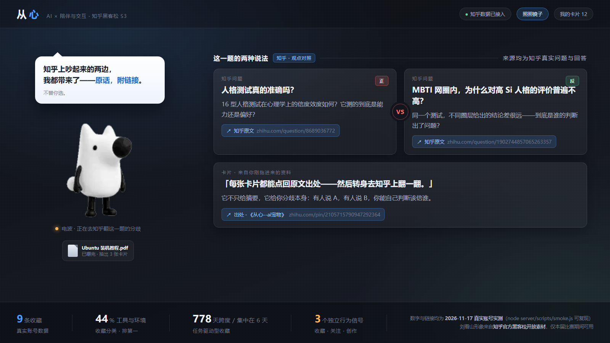

# P1 · 三件产出（AI 起草版 · **已拍板 2026-11-17 22:5x**）

> **状态：🟡 场景与口径已拍板；台词与镜头仍待逐句审。** 这一页里的**内容**（台词、节奏、镜头）必须由人拍板；AI 只负责排版与绘制。
> **每一条都标了来源**：`【实】` = 已实测的真实数据 ｜ `【提】` = AI 提案 ｜ `【已】` = 已拍板 ｜ `【未】` = 契约里已定但**代码还没写**。
>
> **已拍板的三件事（2026-11-17 22:5x）**：
> 1. **主流程一句话 = 候选 A**（出处 + 分歧 + 桌宠干活）
> 2. **照镜子一句话 = 候选 A**（自述 + 行为两侧都说全）
> 3. **口径统一为 67%**（工具与环境 4 + 工程与方法 2 = 6/9），**不用 44%，也不再用 82%**
>
> **事实底座（2026-11-17 实测，`server/scripts/smoke.js` 可复现）**：
>
> | 项 | 真实值 |
> | --- | --- |
> | 收藏 | **9 条**，1 个收藏夹 |
> | 收藏分类 | 工具与环境 4（44%）· 工程与方法 2（22%）· 资讯与生态 1 · 认知与判断 1 · 未归类 1 |
> | **口径（已定）** | **前两类合计 6/9 = 67%** ——「怎么立刻上手」的那一批 |
> | 收藏跨度 | 2023-11-03 → 2025-12-20，**778 天，集中在 6 天** |
> | 关注 | **3 个**：工程与方法 / 资讯与生态 / 职业与行业，**各类各 1 条** |
> | 创作 | **1 条**（pin《从心--ai宠物》），论证结构「痛点式」——**与「步骤式」同分，是弱结论** |
> | ★ 关键原话 | 用户自己在创作里写的：**「我的收藏夹里有 200 篇 PDF，一篇都没用上。」** |

---

## 一、一句话场景 ×2

### 1.1 主流程（3 分钟）　**【已】选候选 A**

> **【已】候选 A**
> 你拖进来一堆资料，桌宠嚼完吐出几张**每张都能点回原文**的卡片；你说「再多说点」，它转身去知乎捞出**真实存在、互相矛盾**的回答——它不给你答案，它把分歧摆在你面前。

备选（未采用，保留备查）

> **【提】候选 B（更强调"陪你干活"）**
> 你在赶一份报告，桌宠一直趴在你手边：你丢给它一份 PDF，它嚼出一叠带出处的卡片；你卡住了，它不催你，它去知乎把**吵得最凶的两方**翻出来摆给你看。

> **【提】候选 C（最强调"不编"）**
> 桌宠不吃黑盒摘要——它吐出的每张卡片都能点回知乎上的真实原回答，连「大家怎么看」也只给**带链接的真实分歧**，不给它自己编的总结。

**为什么选 A**：它一句话里同时装了三样东西——**出处（可信）**、**分歧（创新）**、**桌宠在干活（陪伴）**。
B 的问题在评审只给 3 分钟，"赶报告"这个铺垫太慢；C 最干净但少了"桌宠"这个主角，像在介绍一个检索产品。

### 1.2 照镜子环节（1.5 分钟）　**【已】选候选 A**

> **【已】候选 A**
> 你刚填完问卷说自己是「体系化、长期主义」，桌宠当场把收藏翻出来给你看：**9 条里 6 条是「怎么立刻上手」，而且散在 778 天里的 6 天**——它说「你不是没有体系，你是一遇任务就只做眼前那一步」，然后一道带知乎出处的情境题砸过来。

备选（未采用，保留备查）

> **【提】候选 B（更短更狠）**
> 你说自己是长期主义者，桌宠把 778 天的收藏记录摊开：跨度 778 天，却只集中在 6 天，全是「装环境、跟教程」——断层就在眼前裂开。

> **【提】候选 C（用你自己的话）**
> 你自己写过「我的收藏夹里有 200 篇 PDF，一篇都没用上」——桌宠把这句话，和它数出来的真实收藏结构并排放，中间裂开一道断层。

**为什么选 A**：A 把**自述**和**行为**两侧都说全了（这正是断层的定义），而且数字全部来自真实数据。
C 情绪最狠，但**只用了收藏这一侧的证据**，撑不起 `self_reported_vs_favorites` 这条断层轴——建议把它降级成 A 的**第 3 拍**（见脚本 4:05），当"补刀"用，不当开场。

---

## 二、5 分钟 Demo 逐秒脚本

> **配速**：主流程 3:00 + 照镜子 1:30 + 开场收尾 0:30。
> **主叙事是「桌宠在陪你干活」，不是「我们检索了知乎」**（D29 结论 3）——每一拍都要看得出桌宠在动、话在替用户说。
> **「实」= 屏幕上的数字/链接是真的｜「提」= 台词与镜头是提案｜「未」= 接口在契约里但代码还没写**

### 2.1 开场（0:00 — 0:15）

| 时间 | 画面 | 桌宠台词 | 来源 |
| --- | --- | --- | --- |
| 0:00 | 全屏桌面，桌宠（`idle`）趴右下角，屏幕上一份 PDF 图标 | 「这周的报告材料还在桌面上摆着，我看着都晃。」 | 【提】 |
| 0:15 | 桌宠转头（`greet`），气泡冒出来 | 「要不我先啃一口？」 | 【提】 |

### 2.2 主流程（0:15 — 3:00）

| 时间 | 画面 | 桌宠台词 | 来源 |
| --- | --- | --- | --- |
| 0:15–0:30 | 用户把 PDF 拖到桌宠身上 → 图标被吸入 → 角色轻微缩放 | （无台词） | 【提】交互 · PDF 用前端本地 `pdfjs-dist` 解析 |
| 0:30–0:50 | 桌宠切 `thinking`（电波，头顶亮灯泡） | 「唔…有点硬，我再嚼嚼。」 | 【提】 |
| 0:50–1:15 | 卡片从桌宠位置飞出，排成 3 张，每张右下角有出处角标 | 「嚼出来了。这三张，每张都能点回原文。」 | 【提】 |
| 1:15–1:45 | 镜头推近第 1 张卡片 → 点「出处」→ 新标签打开**知乎原回答** | 「看第一条。这是知乎上**真有人写过的**，不是我编的。」 | 【实】★ 真实知乎链接 |
| 1:45–2:15 | 点「知乎上大家怎么说」→ 桌宠又切电波 → 右侧滑入 **2 张观点卡，来自两个不同的人，观点相反** | 「知乎上吵起来的两边，我都带来了——原话，附链接。」 | 【实】★ `question_recommendations` + `question_answers` |
| 2:15–2:45 | 两张观点卡并排，中间一条若隐若现的分界线（**只做视觉暗示，不解释**） | 「它们说的是反的。我不替你选。」 | 【提】 |
| 2:45–3:00 | 桌宠回 `idle`，卡片收进右侧栏 | 「先放着吧。**用不上的资料，堆着也是心里堵。**」 | 【提】台词 ·【实】呼应后面 4:05 的用户原话 |

### 2.3 照镜子环节（3:00 — 4:30）

| 时间 | 画面 | 桌宠台词 | 来源 |
| --- | --- | --- | --- |
| 3:00–3:10 | 桌宠突然抬头（`cheer`），气泡顶出来 | 「等一下——我看你收藏的这些，跟你刚才说的不太一样。照照镜子？」 | 【提】桌宠**主动发起** |
| 3:10–3:25 | 自述问卷（6 题）→ 出结果 | （用户自己答） | 【未】`POST /api/behavior/tension` |
| 3:25–3:50 | 2.5D 认知地图升起：上层「说的你」/ 下层「做的你」/ 第三层「情境下的你」空着 | 「你说你是**体系化、长期主义**。可你收藏的 9 条里，排前两类的 6 条（工具与环境 4 + 工程与方法 2）全是『**怎么立刻上手**』。」 | 【实】★ 真实收藏 9 条 + 真实分类 ｜【未】`tension` |
| 3:50–4:05 | 「做的你」那层再压一句 | 「而且这 9 条散在 **778 天里的 6 天**。不是持续探索，是一遇任务才动手。」 | 【实】★ 真实跨度 ｜【未】`tension` |
| 4:05–4:15 | 断层在地图上裂开 → **Three.js 真 3D 推镜特写** | 「你自己也写过一句——『**我的收藏夹里有 200 篇 PDF，一篇都没用上**』。」 | 【实】★ 用户自己创作里的原话 |
| 4:15–4:25 | 断层特写上浮出一道情境题（带知乎问题标题 + 链接） | 「那这道呢——你打算怎么让它用上？」 | 【实】★ 情境题必带知乎出处 ｜【未】`situation/question` |
| 4:25–4:30 | 用户答完 → 地图第三层长出一块新地块 | 「行，这块地是你的了。」 | 【未】`terrain/answer` |

### 2.4 收尾（4:30 — 5:00）

| 时间 | 画面 | 桌宠台词 | 来源 |
| --- | --- | --- | --- |
| 4:30–4:50 | 全景 2.5D 地图，三层都有内容了，断层上多了一座桥 | 「从心。你想清楚了什么，它才算数。」 | 【提】 |
| 4:50–5:00 | 回到桌宠（`idle`），落版：作品名「从心」· 赛道 AI × 陪伴与交互 · 一行字「每张卡片都能点回知乎原话」 | | 【提】 |

### 2.5 ★ 这份脚本里每个接口的代码状态

| 契约接口 | 状态 | 实测结果 |
| --- | --- | --- |
| `GET /api/behavior/favorites` / `followees` / `contents` | ✅ 已实现，真调知乎跑通 | 收藏 9 条 / 关注 3 个 / 创作 1 条 |
| `GET /api/quota` | ✅ 已实现 | 9 类额度 |
| `POST /api/behavior/tension` | ✅ **已实现**（22:5x） | 实跑输出断层：「你说你重「长期主义」，但你收藏的 **67%（6/9 条）**是「怎么立刻上手」」，强度 0.67 / 置信度 0.6 |
| `GET /api/terrain` | ✅ **已实现** | 三层各 5 个块，断层标记带 `axis_x/axis_y`（3D 推镜落点） |
| `POST /api/terrain/answer` | ✅ **已实现** | 实跑长出地形块并连上「内倾情感」的桥；伪造 question_id 正确返回 404 |
| `POST /api/situation/question` | ✅ **已实现** | 实跑出题：题面由 `zhida-fast-1p5` 改写，**出处（问题 URL + 原回答链接）来自上游**，模型不给出处 |

> **别把这份脚本当成"已完成"的演示**：接口都通了，但**前端 `web/` 一行都还没写**，
> 而且 3:00 之后的画面（2.5D 地图、3D 推镜、问卷）全是队友那块。

> 复现：`node server/scripts/smoke-cognition.js`

---

## 三、静帧 ×2

| # | 画面 | 用途 | 文件 |
| --- | --- | --- | --- |
| 静帧 1 | **桌宠 + 卡片**：桌宠在左侧电波，右边是带出处角标的卡片与知乎观点对照 | 计划书封面 / Demo 备用画面 | `docs/p1-frames/frame-1-pet-cards.png` |
| 静帧 2 | **2.5D 认知地图 + 断层**：三层透视布局（说的你 / 做的你 / 情境下的你），中间一道裂开的断层 | 计划书核心插图 / 队友对齐 | `docs/p1-frames/frame-2-terrain-fracture.png` |

**静帧 1**

**静帧 2**

**两张都是用真实素材搭的**：刘看山用官方 `assets/kanshan/` 的真帧（**不自绘角色**，D19），地图上的数字与引文全部是真实数据。

> **HTML 稿是源文件**，改文案改排版直接改 `docs/p1-frames/*.html`，然后用本机 Chrome 无头重出 PNG（命令见 `docs/handoffs/2026-11-17-2250-taxonomy-server-p1.md` 第 4 节）。

---

## 四、还需要拍板的 4 件事

> 已拍板的 3 件（场景 A/A、口径 67%）见文首。下面 4 件还等你。

1. **桌宠台词的口语度**：现在的台词偏"温和陪伴"。要不要更活泼一点（"我给你炫一个"）？还是要更克制？
2. **零点几秒开场的"报告材料"**：demo 要不要用**真实的知乎文档**（比如一篇收藏里的 Ubuntu 装机教程）当演示素材？真实素材更硬，但内容偏技术、跟"报告"的叙事不搭。
3. **断层那句话的主语**：现在是「你不是没有体系，你是一遇任务就只做眼前那一步」——**这是断言**。换成更留余地的一句（"我们先看看这是不是"）会不会更安全？
4. **静帧要不要换成"没有刘看山"的版本**：官方 IP **赛后禁商用**（本屆可用）。计划书和 Demo 视频里用没问题，但要不要**额外做一套无 IP 的占位版**，以备赛后继续用？

> **口径已统一为 67%**，并已写进零 J（待你发给队友）——**已发出的零 I 里那个 82% 是示例数字，以零 J 为准。**

---

## 五、这份草稿的诚实边界

- **数字全部来自真实账号实测**（`node server/scripts/smoke.js` 可复现），没有一处是编的。
- **台词、节奏、镜头全是提案**，一句都还没拍板。
- **8 个接口全部通了，但前端 `web/` 一行都还没写**——脚本是"要长成什么样"，不是"已经长成了"。
- **创作信号只有 1 条样本**，论证结构是弱结论——演示时不要拿它当结论讲。
- **断层文案里的 67% 是「工具与环境 4 + 工程与方法 2」两类合计**，分类口径见 `contracts/taxonomy.json`；如果队友改了类目，这个数会变。
